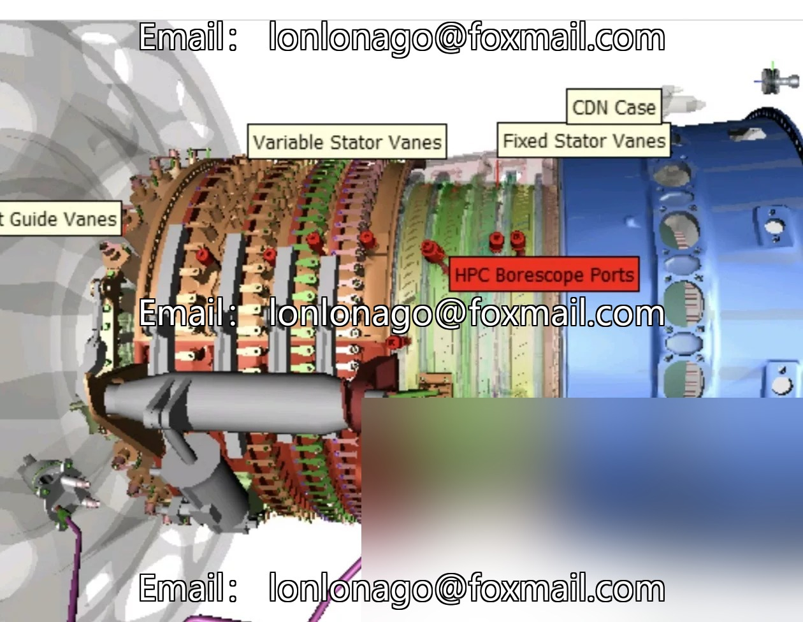
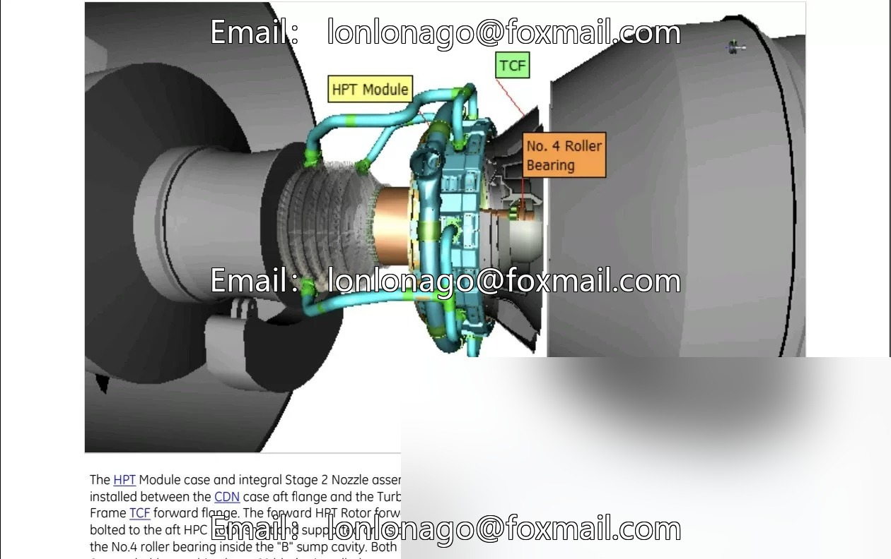
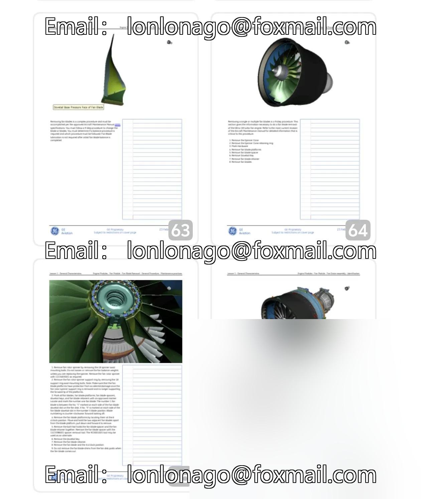
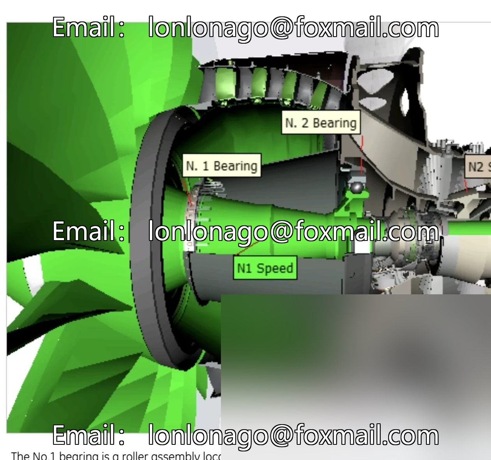

# GE Aviation (General Electric Aviation) Official-published 《GEn

## Body

GE Aviation (General Electric Aviation) official-released 《GEnx-1B Route Maintenance Course》 training document 890-page PDF electronic file.
Document theme: GEnx-1B Line Maintenance Course. This is a route-level maintenance training course for GEnx-1B engines (mainly used for Boeing 787 Dreamliner engines). The content typically covers routine inspections, common fault troubleshooting, and route-replaceable component disassembly and installation in frontline maintenance work.

This is the official GE Aviation training document for the GEnx-1B Line Maintenance Course, an 890-page PDF covering route-level maintenance of the GEnx-1B engine.

<!-- AI_ENRICHED -->

## Images

## Payment

Here is a pay link on Stripe ( https://buy.stripe.com/3cs8yP7sY87d0vu9AB ). Please contact me lonlonago@foxmail.com after funding $89, and I will send you a complete data files , thank you!

